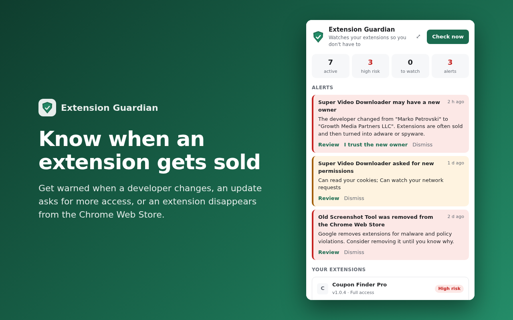

# Extension Guardian

Get warned when a Chrome extension you use is sold, gains new permissions, or disappears from the Chrome Web Store.

[](https://chromewebstore.google.com/detail/extension-guardian/mpceklcidiadoneogfmpkjpadihmlcjd)
[](LICENSE)

**[Install from the Chrome Web Store](https://chromewebstore.google.com/detail/extension-guardian/mpceklcidiadoneogfmpkjpadihmlcjd)** · Free · No account · No analytics

Not ready to install anything? **[Check a single extension on the web](https://guardian.tinyward.org)**: paste its store link to see who makes it, how many people use it, and whether it's maintained. See also the [report on the 150 most popular Chrome extensions](https://guardian.tinyward.org/report/popular-chrome-extensions-2026) and, for extension developers, [what to do when someone offers to buy your extension](https://guardian.tinyward.org/developers/offer-to-buy-your-extension).



Part of **Tinyward**, small privacy tools with as few permissions as possible. Also from Tinyward: [Unseen](https://github.com/laboskiriste/unseen), which blocks email tracking pixels in Gmail.

## Why

Extensions get sold. The new owner pushes an update, Chrome installs it silently, and a tool you have trusted for years starts injecting ads or collecting browsing data. Chrome doesn't tell you when the developer behind an extension changes. Extension Guardian does.

## What it does

- **Owner changed**: the developer listed in the Chrome Web Store is different from before, the usual sign of a sale.
- **New permissions**: an update asks for more access, such as reading every website.
- **Removed from the store**: Google often takes malware down this way.
- **Installed behind your back**: extensions added by another program, or updating from outside the store.

When an extension is removed from the store, Guardian says what to do next and, for well-known ones such as uBlock Origin, what to use instead.

**Keep off on these sites** (Chrome): pick sites where an extension should never run, such as your bank. Guardian turns it off while one of those sites is open in any tab and back on when you close it. This needs the optional `tabs` permission, which Chrome asks for only when you add a first site. The address is checked on your device and never sent anywhere.

Every extension shows:

- **Access** (full, limited, basic): what its permissions let it do, in plain language, and how far its site access reaches.
- **Warning signs** (attention required, review recommended, no warning signs): the changes and facts we can see, such as a new owner, new permissions, removal from the store or an install by another program. Users, update date and developer details are shown as context, not judged.
- **A suggested action** (act now, worth a look, nothing to do now). Full access is never "nothing to do": a password manager needs it, but it is still worth knowing.

Guardian reads declared permissions and public store information, not code. An extension can turn harmful without any visible change, so "no warning signs" is never a guarantee of safety.

## Privacy

Your list of extensions and every result stay on your device. Chrome doesn't let extensions read Chrome Web Store pages, so a small server reads the public store page instead. The extension sends it only extension IDs, which are public identifiers, and nothing about you. It does not log or store IP addresses. [Privacy policy](https://guardian.tinyward.org/privacy).

## Repository

| Folder | What it is |
| --- | --- |
| [`extension/`](extension) | The browser extension for Chrome and Firefox (Manifest V3, no build step). See its [README](extension/README.md). |
| [`server/`](server) | Cloudflare Worker that reads Chrome Web Store pages for the extension and serves the [web checker](https://guardian.tinyward.org), plus a Node dev server |
| [`store/`](store) | Store listing text and screenshots |

## Run it locally

```bash
cd server && npm install && npm start      # server on http://localhost:8787
cd extension && npm test                 # extension tests
```

Point `extension/src/config.js` at `http://localhost:8787`, open `chrome://extensions`, turn on Developer mode, and load the `extension` folder with **Load unpacked**.

## Feedback

False alarms and missed warnings are the most useful reports. Please [open an issue](../../issues) and include the extension's store link.

## Support

Extension Guardian is free, with no ads and no tracking. If it is useful to you, you can [sponsor the developer on GitHub](https://github.com/sponsors/laboskiriste). Nothing is locked behind it.

## License

[MIT](LICENSE)
