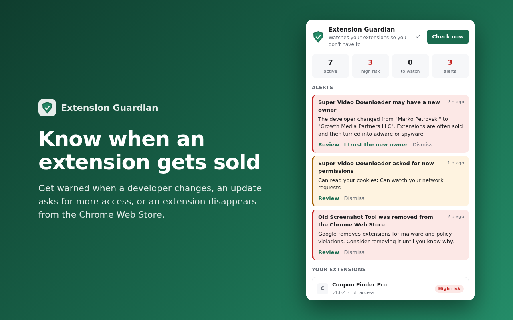

# Extension Guardian

Get warned when a Chrome extension you use is sold, gains new permissions, or disappears from the Chrome Web Store.

[](https://chromewebstore.google.com/detail/extension-guardian/mpceklcidiadoneogfmpkjpadihmlcjd)
[](LICENSE)

**[Install from the Chrome Web Store](https://chromewebstore.google.com/detail/extension-guardian/mpceklcidiadoneogfmpkjpadihmlcjd)** · Free · No account · No analytics

Not ready to install anything? **[Check a single extension on the web](https://app.extensionguardian.workers.dev)**: paste its store link to see who makes it, how many people use it, and whether it's maintained.



Part of **Tinyward**, small privacy tools with as few permissions as possible. Also from Tinyward: [Unseen](https://github.com/laboskiriste/unseen), which blocks email tracking pixels in Gmail.

## Why

Extensions get sold. The new owner pushes an update, Chrome installs it silently, and a tool you have trusted for years starts injecting ads or collecting browsing data. Chrome doesn't tell you when the developer behind an extension changes. Extension Guardian does.

## What it does

- **Owner changed**: the developer listed in the Chrome Web Store is different from before, the usual sign of a sale.
- **New permissions**: an update asks for more access, such as reading every website.
- **Removed from the store**: Google often takes malware down this way.
- **Installed behind your back**: extensions added by another program, or updating from outside the store.

Every extension gets two ratings:

- **Access** (full, limited, basic): what its permissions let it do, in plain language.
- **Risk** (high, watch, low): whether to trust it. A password manager needs full access, so full access alone isn't treated as danger. Risk comes from the warnings above plus store signals: who makes it, how many people use it, and whether it is maintained.

## Privacy

Your list of extensions and every result stay on your device. Chrome doesn't let extensions read Chrome Web Store pages, so a small server reads the public store page instead. The extension sends it only extension IDs, which are public identifiers, and nothing about you. It does not log or store IP addresses. [Privacy policy](https://app.extensionguardian.workers.dev/privacy).

## Repository

| Folder | What it is |
| --- | --- |
| [`extension/`](extension) | The browser extension for Chrome and Firefox (Manifest V3, no build step). See its [README](extension/README.md). |
| [`server/`](server) | Cloudflare Worker that reads Chrome Web Store pages for the extension and serves the [web checker](https://app.extensionguardian.workers.dev), plus a Node dev server |
| [`store/`](store) | Store listing text and screenshots |

## Run it locally

```bash
cd server && npm install && npm start      # server on http://localhost:8787
cd extension && npm test                 # extension tests
```

Point `extension/src/config.js` at `http://localhost:8787`, open `chrome://extensions`, turn on Developer mode, and load the `extension` folder with **Load unpacked**.

## Feedback

False alarms and missed warnings are the most useful reports. Please [open an issue](../../issues) and include the extension's store link.

## License

[MIT](LICENSE)
